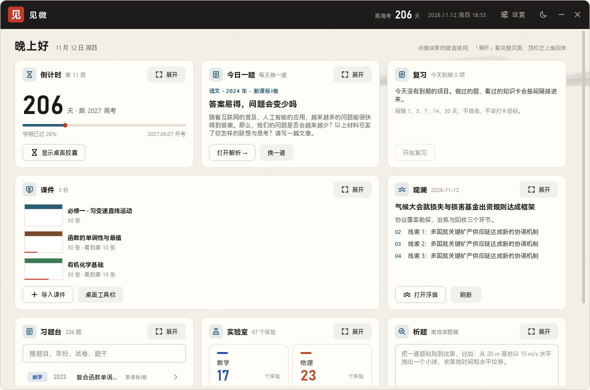
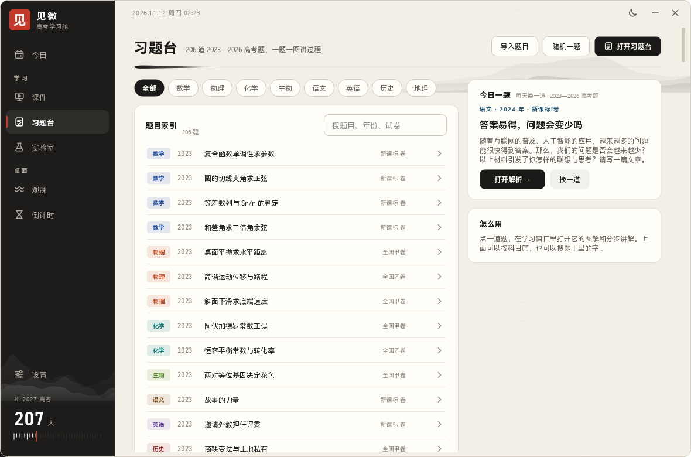
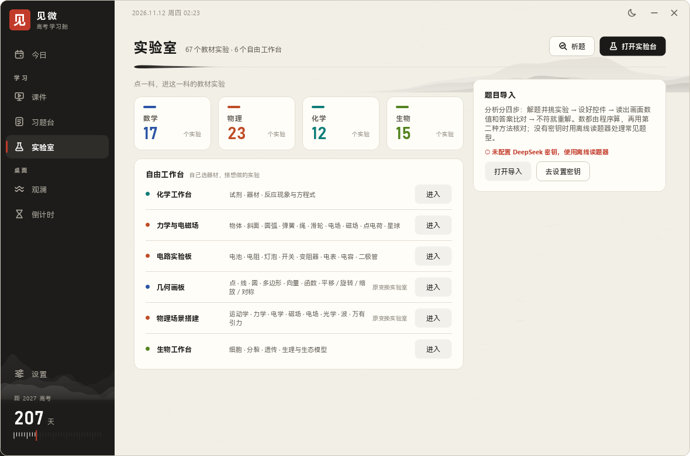
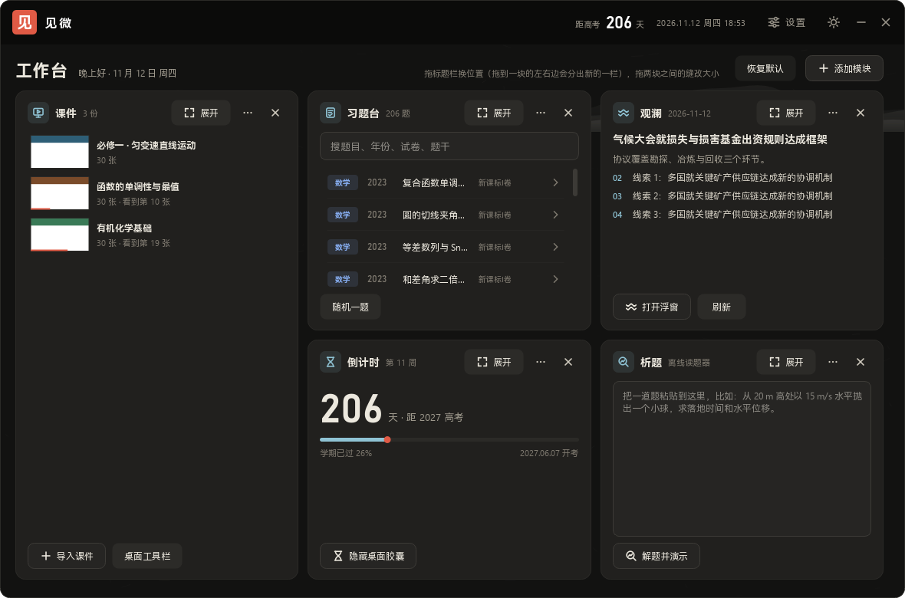
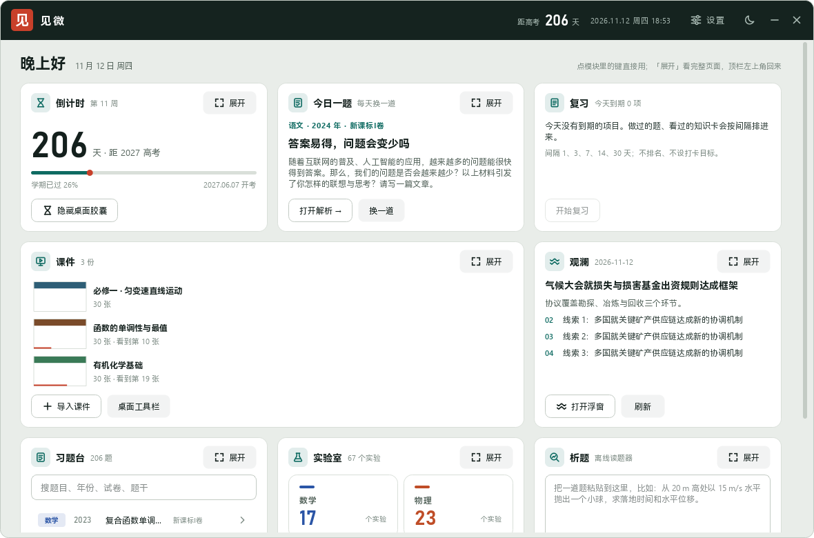
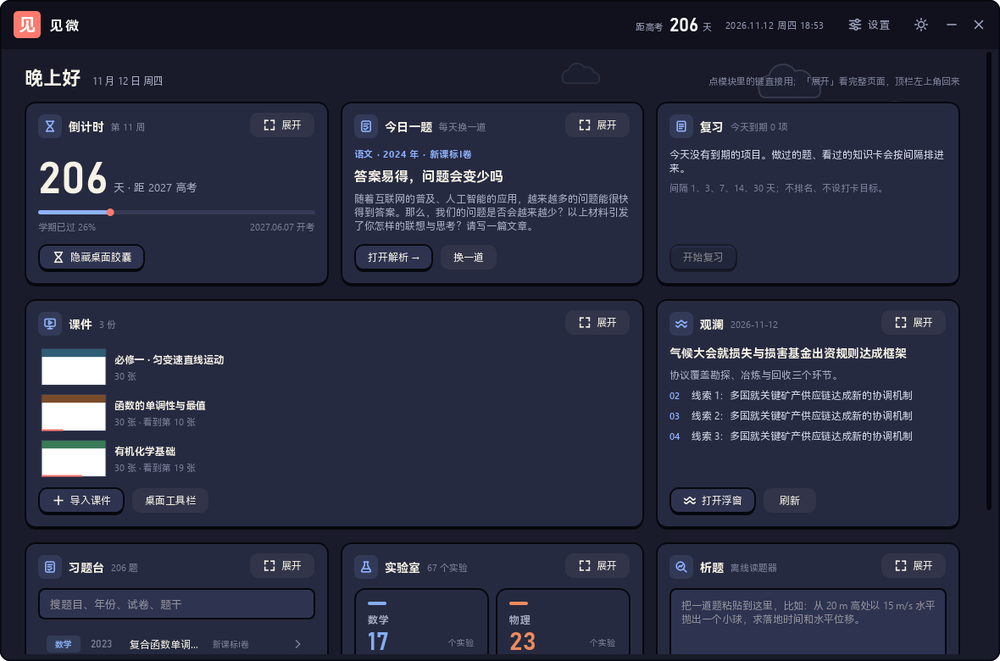
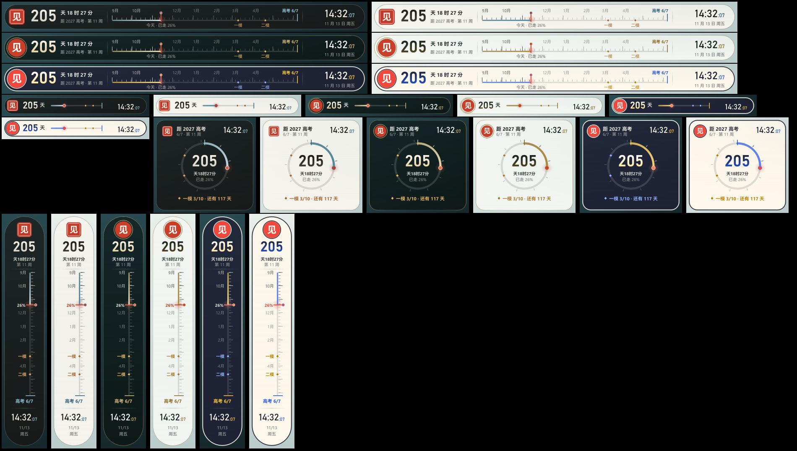
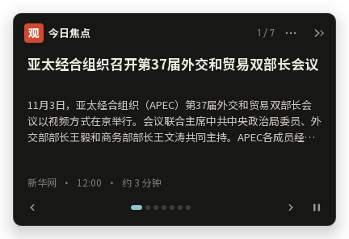

<div align="center">



# 见微 · 高考学习舱

**把刷题、实验、课件、新闻和倒计时，装进一个 Windows 桌面程序。**

*Jianwei — a Windows desktop study cockpit for China's Gaokao: animated past-paper walkthroughs, 67 interactive science labs, AI problem analysis checked by real solvers, a slide player with pens and a blackboard, a daily news reader and a desktop countdown.*

[](https://github.com/ShenShangUtopia/jianwei/releases/latest)


[**下载最新版**](https://github.com/ShenShangUtopia/jianwei/releases/latest) · [全部版本](VERSIONS.md) · [功能一览](#功能一览) · [快速开始](#快速开始)

</div>

---

## 为什么做见微

高三的一天被切成很多碎片：一道题要看懂过程，一个实验课本上只有一张图，老师的课件要再翻一遍，新闻素材要攒，离高考还有多少天要心里有数。
见微把这些放在**同一个窗口、同一个托盘图标**里——打开就能用，不联网也能用，数据只留在自己电脑上。

## 功能一览

| 模块 | 能做什么 |
| --- | --- |
| 📝&nbsp;**习题台** | 206 道 2023–2026 高考题（九科），每题一张图、分步播放讲解；知识卡、错题本、三级提示、导出图片；可导入自己的题、自己搭物理场景 |
| 🧪&nbsp;**实验室** | 67 个教材实验（数学 17 · 物理 23 · 化学 12 · 生物 15），全部可拖、可调、会动；另有 6 个自由工作台：化学、力学与电磁场、电路、几何画板、物理场景搭建、生物 |
| 🔍&nbsp;**析题** | 粘贴一道题：AI 读题列式，**程序再独立算一遍并逐项核对**，对不上就打回重做；17 类常见题型有程序求解和分步图解（抛体、斜面、碰撞、电路、透镜、函数、圆锥曲线、立体几何、概率、数列、化学平衡、遗传……）。没有密钥时用离线读题器 |
| 🖥️&nbsp;**课件** | 导入 PPT / Word / PDF / 图片直接放映，保留动画；笔、荧光笔、激光笔、套索；框选一块内容带进黑板或联网查询；黑板可分屏、可放到第二块屏 |
| 🌊&nbsp;**观澜** | 每天自动筛出 7 条世界线索，配一位人物、几句金句、一个格局词条；可做成桌面浮窗；每晚 22:20 全屏「暮省」回看这一天 |
| ⏳&nbsp;**时间胶囊** | 贴在桌面上的高考倒计时：一把从开学走到考试日的时间尺，可加一模、二模等节点，鼠标移上去看任意一天 |
| 🎓&nbsp;**AI 课堂** | 0.3 起整合开源项目 OpenMAIC，在本机跑一间多智能体互动课堂 |

另外：间隔复习队列、学习记录、单文件备份与恢复、全局快捷搜索（`Ctrl+K`）。

## 截图

<table>
<tr>
<td width="50%"><br><sub><b>习题台</b> · 206 道真题，按科目筛选、全文搜索</sub></td>
<td width="50%"><br><sub><b>实验室</b> · 67 个教材实验 + 6 个自由工作台</sub></td>
</tr>
<tr>
<td><br><sub><b>工作台布局 · 夜间</b> · 模块随意拖放、拼成自己的桌面</sub></td>
<td><br><sub><b>观澜 · 宽版报纸</b> · 焦点、线索、人物金句一眼看全</sub></td>
</tr>
</table>

### 三种风格 × 昼夜 × 三种页面布局

<table>
<tr>
<td width="50%"><br><sub><b>青瓷</b> · 白天</sub></td>
<td width="50%"><br><sub><b>手绘</b> · 夜间</sub></td>
</tr>
</table>

风格：**水墨**（默认）/ **青瓷** / **手绘**；主题：白天 / 夜间 / 跟随时间；页面布局：**经典页面** / **模块桌面** / **工作台**；疏密：标准 / 紧凑。

### 桌面上的两个小东西


<sub><b>时间胶囊</b> · 横尺 / 迷你 / 方块 / 竖条四种版式，每种都跟随三种风格和深浅底色</sub>

<br><br>

 

<sub><b>观澜</b> · 除了侧栏面板和宽版报纸，还能缩成一张自动轮换的卡片，或一条滚动标题的细横条</sub>

## 快速开始

1. 打开 [Releases](https://github.com/ShenShangUtopia/jianwei/releases/latest)，下载 `jianwei-green-<日期>-<版本>.zip`；
2. 解压到任意文件夹（`Jianwei.exe` 要和 `_internal` 文件夹放在一起）；
3. 双击 `Jianwei.exe`。第一次运行如果出现「Windows 已保护你的电脑」，点 **更多信息 → 仍要运行**（程序没有代码签名）。

启动后右下角托盘会多一个「见微」图标；关掉主窗口只是收进托盘，彻底退出用托盘菜单。

**析题用 DeepSeek（可选）**：设置 → DeepSeek 题目分析，粘贴自己的密钥。密钥只保存在本机 `%LOCALAPPDATA%\Jianwei\deepseek.env`。

**系统要求**：Windows 10 / 11 64 位，屏幕 1366×768 以上，支持触屏和手写笔。

<details>
<summary><b>常用快捷键</b></summary>

| 场景 | 按键 |
| --- | --- |
| 全局 | `Ctrl+K` 快速打开 · `Alt+Shift+G` 呼出 / 收起观澜 |
| 习题台 | `← →` 上一步 / 下一步 · `空格` 播放 · `R` 重播 · `A` 答案 · `S` 加入错题 · `1 2 3` 提示 · `Ctrl+E` 导出图片 · `?` 全部快捷键 |
| 课件 | `← →` 翻页 · `P` 笔 · `H` 荧光笔 · `E` 橡皮 · `L` 激光笔 · `S` 框选 · `G` 目录 · `Ctrl+Z` 撤销 · `Esc` 逐层退出 |
| 观澜 | `1–4` 切页 · `← →` 换一条 · `R` 重新筛选 · `Ctrl+P` 自动播放 / 轮换 · `Esc` 收起 |

</details>

<details>
<summary><b>数据放在哪 · 怎么卸载</b></summary>

所有设置、错题、笔迹、新闻档案都在 `%LOCALAPPDATA%\Jianwei\`。
备份：设置里的「单文件备份」，或直接拷走这个文件夹。
卸载：删掉程序文件夹和这个数据文件夹即可，不写注册表、不装服务。

</details>

## 它是怎么做的

- **Python + PySide6（Qt 6）**，学习界面全部用 QPainter 原生绘制：题目图解、实验、工作台、观澜、胶囊都不依赖浏览器内核。0.2 起从「网页套壳」改写成原生程序，安装包从约 400 MB 降到几十 MB。
- **AI 只读题、程序算数**：析题时 AI 负责理解题意、写出方程模型，答案由程序解方程 / 数值积分 / 守恒量独立复算；两边不一致就让 AI 重新检查，界面上逐项对照。
- **实验是模型不是动画**：物理用数值积分推进，化学有配平和平衡计算，生物的酶、光合、细胞分裂按规则推出读数。
- 用 PyInstaller 打包成免安装的绿色版；0.3 版本因为附带 AI 课堂的本地运行环境（Node + PostgreSQL），体积较大。

## 版本历程

| 阶段 | 版本 | 时间 | 主要变化 |
| --- | --- | --- | --- |
| 起步 | v0.1.0 – v0.1.7 | 2026-11-03 → 11-05 | 桌面托盘 + 观澜 + 倒计时 + 网页版习题台与格物实验台；AI 题目分析与程序复算 |
| 原生化 | v0.2.0 – v0.2.17 | 2026-11-05 → 11-09 | 全部改写为原生界面；课件放映与黑板、框选查询、青瓷美术、析题讲解舞台、学习闭环与备份 |
| 课堂与外观 | v0.3.0 – v0.3.5 | 2026-11-10 → 11-12 | 整合 OpenMAIC 课堂；性能优化；水墨 / 青瓷 / 手绘三种风格；三种页面布局 |
| 测试版 | v0.3.5-layouts-test | 2026-11-13 | 时间胶囊、观澜各新增三种版式（仅绿色版） |

每个版本的下载和对应源码见 [**VERSIONS.md**](VERSIONS.md)。

## 仓库结构

这个仓库是见微的**完整版本归档**：

| 位置 | 内容 |
| --- | --- |
| [`source/`](source) | 36 个源码快照（`见微-源码-<日期>-<版本>.zip`），v0.1.0 → v0.3.5，一个不少 |
| [Releases](https://github.com/ShenShangUtopia/jianwei/releases) | 37 个绿色版，一个版本一个 Release（tag 即版本号）。构建产物单个 31–245 MB，超过 GitHub 仓库单文件 100 MB 上限，所以放在 Release 附件里 |
| [`VERSIONS.md`](VERSIONS.md) | 版本索引：日期、体积、源码文件名、对应 Release |
| [`SHA256SUMS`](SHA256SUMS) | 全部源码包的校验和 |

<details>
<summary><b>取用某个版本的源码 · 校验完整性</b></summary>

```bash
git clone https://github.com/ShenShangUtopia/jianwei.git
cd jianwei
unzip "source/见微-源码-2026-11-12-v0.3.5.zip" -d jianwei-v0.3.5
```

```bash
sha256sum -c SHA256SUMS                 # Linux / macOS
```

```powershell
Get-FileHash source\*.zip               # Windows，逐条和 SHA256SUMS 比对
```

几点说明：

- 每个 zip 是那一刻的完整目录树，不是逐次提交的 Git 历史；想看两版之间改了什么，解开相邻两版做 diff。
- 同一天常有多个补丁版（如 `v0.2.12 → v0.2.12.1 → v0.2.12.2`），都保留了。
- 源码包在 v0.2.0 处从约 13 MB 降到约 1.5 MB：v0.1.x 的包里带了构建产物和依赖，v0.2.0 起是纯源码。

</details>

## 致谢

- [OpenMAIC](https://github.com/THU-MAIC/OpenMAIC)（MIT）——AI 课堂部分
- [DeepSeek](https://www.deepseek.com/)——析题与识图使用的模型接口
- [VeloΦ](https://github.com/Stevenzhang543/VeloPhi)——「AI 读题、程序算数、逐步校验」思路的启发

---

<div align="center"><sub>个人项目，暂未附开源许可证；如需使用或转载请先联系作者。</sub></div>
